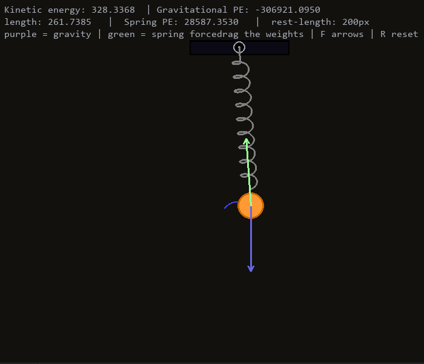

<h1 align="center">Spring-mass simulator <h1>

<p align="center">
A 2D interactive spring-mass simulator built using <b>Python</b> and its libraries like <b>Numpy</b> and <b>Pygame</b>.
</p>

<p align="center">
  
  
  
  
</p>

<p align="center">
  
</p>

---

## 📖 About this project.
This project simulates a mass and spring attached to a rigid surface where the mass moves with various 
forces acting on it like **gravity**, **spring-force** and **damping force**.
I created this project since I wanted to apply my therotical knowledge that I learned in school practically and figure out how simulations work.

## ✨ Features:
- **interactive simulation** - you can see how springs behave and also drag the mass
- **Hooke's law** - uses hooke's law to simulate spring behaviour
- **damping** - the oscillation slowly loses energy due to damping just like irl
- **numerical simulation** - in each frame physics is calculated 20 times so there is less error.

## 🎥 Demo (Watch a pre-recordered video of simulation)
[watch](https://github.com/user-attachments/assets/b9cd39bc-b921-4c9a-a1f5-c5aeedcd147c) the spring-mass system oscillate under gravity, and interact with the simulation.

## 📐 Equations used in this project:
- **Hooke's law**: F = -Kx
- **Newton's 2nd law**: F = ma
- **Damping eqn in 2D** = - Damping coefficient x velocity

## Built with:
```bash
- Python
- Numpy
- Pygame
```

## Ignore:
numpy folder, pygame folder, rough folder 
because before this project I had zero knowledge about pygame, numpy and simulating physics I had to learn those so I experimented in those folder.

## 🚀 How to run:
**Option 1**: Download the Executable (**Recommended**)
1. Go to [Releases](https://github.com/sevenbuilds/2D-python-/releases/tag/Simulation_v1.0.0) page.
2. Download SpringMass.exe from the lastest release.
3. Double-click the downloaded file so launch the simulation.
4. If faced with "Windows protection" click more info down below.
5. choose the option "Run anyway".
6. Enjoy the simulation!

---

**Option 2**: Run from source
if you want to run or modify the code:
- you must have **Python 3.13**, **Pygame CE** and **Numpy**.

Install the dependencies:
```bash
pip install pygame-ce numpy
```
Clone the repository:
```bash
git clone https://github.com/sevenbuilds/2D-python-
```
Navigate to the project directory:
```bash
cd 2D-python-
```
Run the simulation:
```bash
python spring_mass.py
```

## Additional info:
I created this project to visualize physics behaviour to learn more clearly since I'm a visual learner and AI is only used to for learning, clearing doubts and ideas, I tried creating a more advanced 
system with semi-annulus, 3 springs and a rolling mass inside it but failed, I realized I lack the knowledge to create those after all I'm just a high school kid but I'll be trying in future to create those complex simulation as I learn more. I was learning physics and trying to create that system for this project but due to time constraint I'm unable to but I'll be improving it in future projects.

## 📄 License

This project is licensed under the MIT License.

## Contact

GitHub: [@sevenbuilds](https://github.com/sevenbuilds)

---

<p align="center">⭐ If you found this useful, consider starring the repo!</p>
